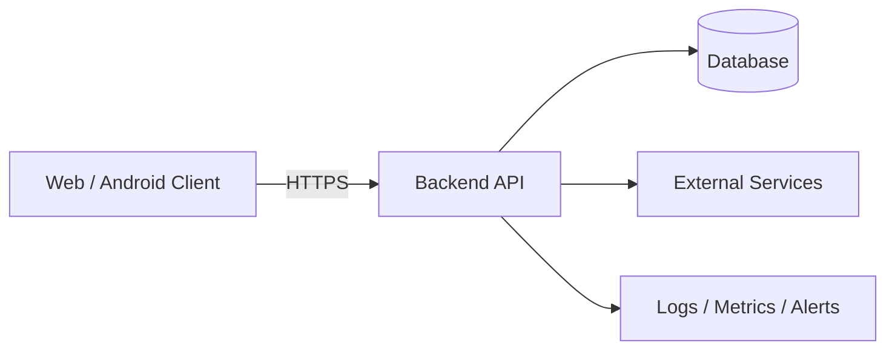

# Architecture and Technical Decisions

## 1. Architecture overview
Describe components and trust boundaries. Add a diagram (Mermaid is fine) and explain every data flow.

Adapt this diagram; it is not a mandated stack.

## 2. Stack decision
| Layer | Choice | Version/support policy | Why | Alternatives considered |
|---|---|---|---|---|
| Web UI / Android UI | [TODO] | [TODO] | [TODO] | [TODO] |
| Backend/API | [TODO] | [TODO] | [TODO] | [TODO] |
| Database | [TODO] | [TODO] | [TODO] | [TODO] |
| Identity/auth | [TODO] | [TODO] | [TODO] | [TODO] |
| Hosting | [TODO] | [TODO] | [TODO] | [TODO] |
| Monitoring | [TODO] | [TODO] | [TODO] | [TODO] |

Choose the simplest stack the team can maintain. Do not place privileged business logic, private keys, or authorization decisions only in the client.

## 3. Boundaries and responsibilities
For each module/service document what it owns, what it may call, and what it must not do. Avoid circular dependencies and duplicated sources of truth.

## 4. Environments
- Local development: [TODO]
- Automated test: [TODO]
- Staging: [TODO]
- Production: [TODO]

Production data must not be copied to development unless explicitly approved and appropriately minimized/de-identified. Use synthetic data by default.

## 5. Configuration and secrets
- Configuration comes from environment/configuration management.
- `.env.example` lists variable names and safe placeholders only.
- Never commit real credentials, signing keys, access tokens, production dumps, or private certificates.
- Rotate any secret accidentally exposed; deleting the commit alone is not enough.
- Keep privileged server credentials on the server, not in browser bundles or Android APKs.

## 6. Database and migrations
- Schema changes are versioned and reviewed.
- Migrations must be repeatable or safely guarded and have a rollback/forward-repair plan.
- Add constraints and indexes deliberately.
- Define transaction boundaries and concurrency behavior.
- Test migrations on a production-like staging copy of synthetic data.

## 7. External services
For each integration document data sent, purpose, auth mechanism, timeout/retry policy, rate limits, failure behavior, vendor retention, and exit strategy.

## 8. Architecture Decision Record (ADR)
For consequential decisions, copy `11_ADR_TEMPLATE.md`. Document trade-offs rather than pretending there is one universally best stack.
